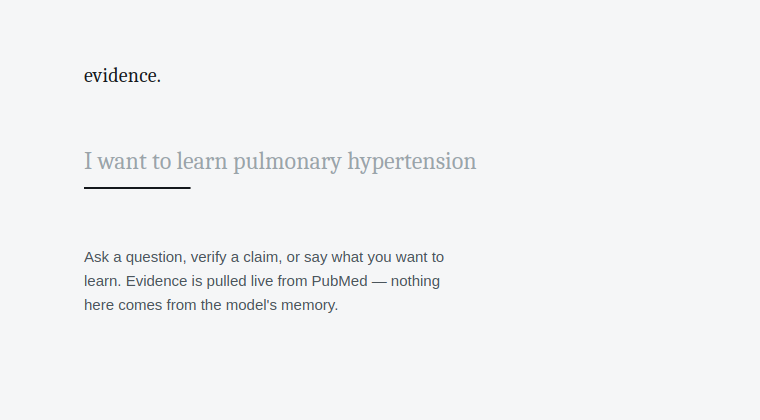
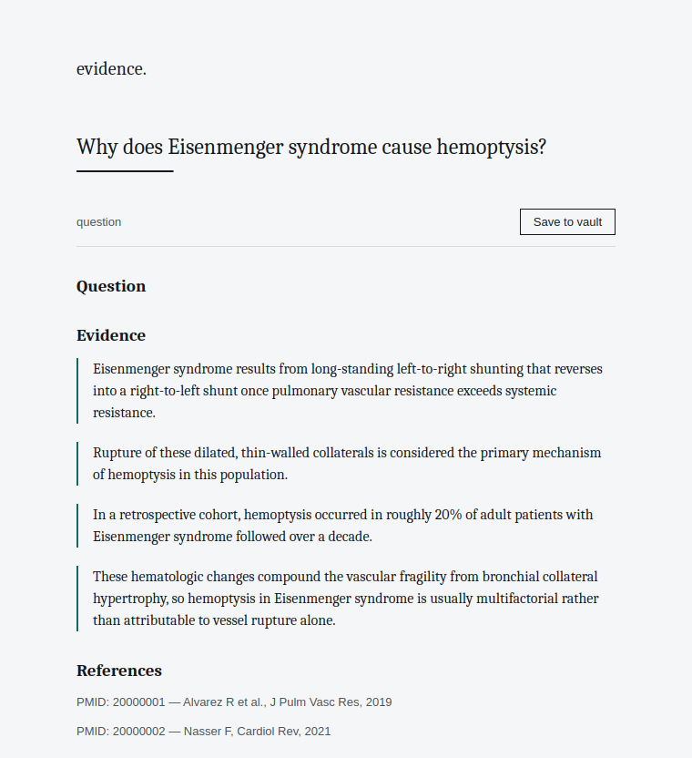
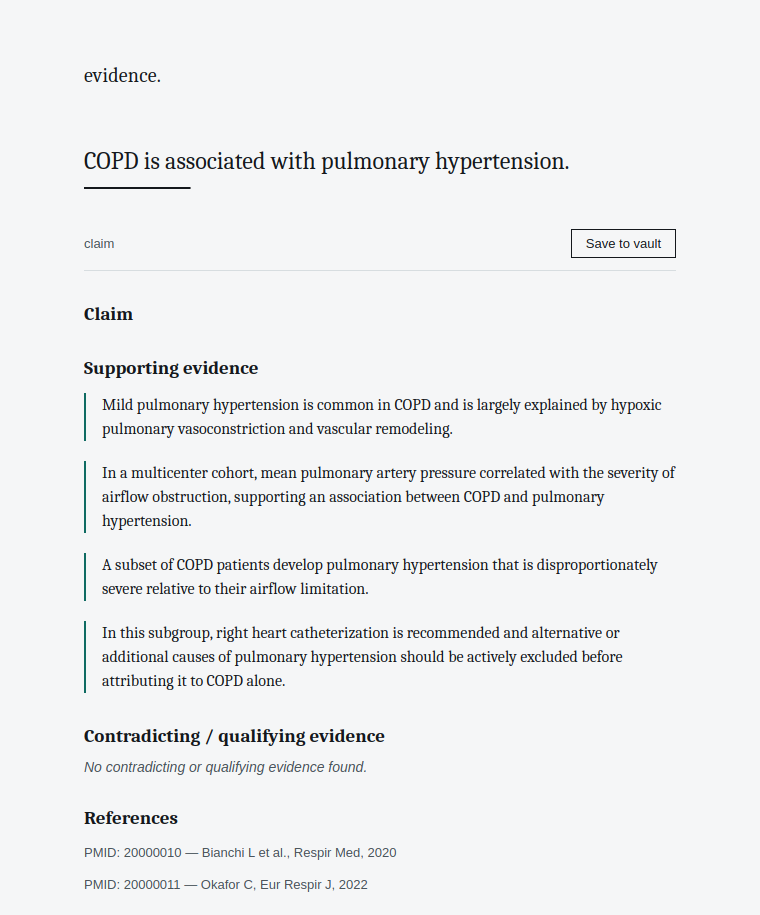
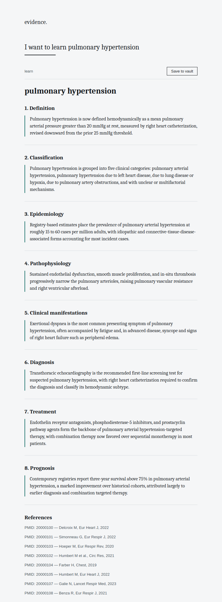

<p align="center">
  
</p>

<p align="center">
  A minimal Linux desktop instrument that turns PubMed into a searchable,
  Obsidian-exportable evidence base for medical learning.
</p>

<p align="center">
  <a href="#install"></a>
  <a href="LICENSE"></a>
  <a href="#tests"></a>
  <a href="#the-model"></a>
</p>

```
User → Local Decision Model → PubMed / PMC → Evidence → Markdown → Obsidian
```

The local model never states a medical fact from memory. It only classifies,
ranks, and **selects indices** into text that was actually fetched from
PubMed/PMC. Code — never the model — turns a selected index back into the
sentence that ends up in your notes. See
[`app/evidence/extract.py`](app/evidence/extract.py) for why that
distinction is the whole point of this app.

## Screenshots

All four are genuine captures of the real app running (real local HTTP
server, real WebView, real render path) — not mockups. Ollama/PubMed calls
are swapped for deterministic offline fixtures for reproducibility; see
[Honest limitations](#honest-limitations).

<p align="center"></p>

<p align="center"><em>Question mode</em></p>
<p align="center"></p>

<p align="center"><em>Claim mode — supporting vs. contradicting/qualifying evidence, split</em></p>
<p align="center"></p>

<p align="center"><em>Learn mode — structure generated per-topic, not hard-coded</em></p>
<p align="center"></p>

## Why this exists

Most "AI + PubMed" tools let a language model answer from its training
data and decorate the answer with citations after the fact. This does the
opposite: the model is only ever allowed to **route and select**; every
sentence that reaches your notes is copied verbatim, by code, from a real
PubMed/PMC response, with full provenance (PMID, DOI, section, source
type). If there isn't enough evidence, it says so instead of filling the
gap from memory.

## Install

### Option A — AppImage (self-contained, no system GTK required)

```bash
chmod +x PubMedLab-x86_64.AppImage
./PubMedLab-x86_64.AppImage
```

This bundles PyQt5 + QtWebEngine so it doesn't depend on the host having
GTK3/WebKit2GTK installed — it only needs a `python3` (≥3.10) already on
the system, which virtually every desktop Linux distribution ships. See
[Building the AppImage](#building-the-appimage) for how it's built, and
[Troubleshooting](#troubleshooting) if the window doesn't open.

### Option B — from source

```bash
git clone https://github.com/aridelaine-sketch/pubmed-lab.git
cd pubmed-lab
python3 -m venv .venv && source .venv/bin/activate
pip install -r requirements.txt
./scripts/setup.sh          # installs Ollama if missing, pulls the model
python -m app.ui.main
```

## The model

**No, the model weights are not in this repository, and that's deliberate,
not a shortcut.** A quantized 8B model (what's recommended below) is
roughly 4.5–5.5 GB. GitHub hard-blocks any file over 100 MB without Git
LFS, and LFS's free tier (1 GB storage / 1 GB bandwidth per month) would
be exhausted by a single clone. More fundamentally, it's the wrong place
for it: Ollama, LM Studio, and every other local-model tool keep weights
in their own store, decoupled from application code, precisely so a model
swap or version update doesn't mean re-downloading a multi-gigabyte git
repo.

What ships instead is automation so the gap never becomes your problem:

- `scripts/setup.sh` installs Ollama if it's missing and pulls the
  configured model.
- `app/decision_model/ensure_model.py` runs at app startup, checks
  whether the model is present via Ollama's own API, and pulls it with
  visible progress if not — see `tests/test_ensure_model.py` for this
  running against a real (fake, for-testing) Ollama-shaped server.

```bash
export OLLAMA_MODEL="qwen3:8b"   # default; any Ollama model works
```

Swapping the model, or the runtime entirely (llama.cpp, an API model),
means implementing `DecisionModel` (see `app/decision_model/base.py`) —
nothing else in the app changes.

## Architecture

```
app/
  decision_model/   typed-decision schemas + swappable backends (Ollama, fake/test)
  pubmed/           real NCBI E-utilities + PMC OA/BioC clients, rate-limited
  evidence/         index-based extraction — the anti-hallucination core
  storage/          SQLite: papers cache, evidence provenance, notes
  export/           Obsidian-compatible Markdown for all three modes
  orchestrator/     sequencing: decide → search → extract → decide again → render
  ui/               stdlib HTTP server + minimal HTML/CSS/JS, wrapped by pywebview
assets/             logo source (SVG) + rendered icons
screenshots/        real captures, see above
demo/               offline fixtures so the pipeline is provable without live deps
tests/              15 tests: unit + real-HTTP + real-fake-Ollama integration
```

## Tests

```bash
python -m pytest tests/ -v
```

15/15 passing, including a real HTTP integration test that starts the
actual local server and a real (fake, for-testing) Ollama-shaped server
for the model-bootstrap logic — not just direct function calls.

## Offline demo (no Ollama, no internet required)

```bash
python -m demo.run_demo
```

Runs all three modes through the **real** orchestrator, evidence
extractor, SQLite store, and Markdown exporter. Only the PubMed engine and
the decision model are swapped for deterministic fixtures — see
`demo/mock_pubmed.py` and `app/decision_model/fake_backend.py`, both
clearly marked. Swapping either back to the real thing is a one-line
change in `app/ui/main.py`.

## Building the AppImage

```bash
pip install --target=build/AppDir/usr/lib/pubmed-lab/vendor \
  httpx pydantic pywebview PyQt5 PyQtWebEngine
cp -r app build/AppDir/usr/lib/pubmed-lab/app
# AppRun, *.desktop, and the icon are already in build/AppDir/ (see assets/)
./appimagetool build/AppDir PubMedLab-x86_64.AppImage
```

## Troubleshooting

**AppImage window doesn't open / crashes on launch.** QtWebEngine (the
bundled renderer) needs a small set of shared libraries most desktops
already have via X11/GTK. If missing:
```bash
sudo apt install libnss3 libxcomposite1 libxrandr2 libxdamage1 libgbm1 libasound2
```

**"Could not reach Ollama."** Run `ollama serve` in a terminal, or check
it's running with `ollama list`.

**Model pull is slow.** That's the one-time multi-gigabyte download
discussed above — it's cached by Ollama afterward, not re-downloaded per
run.

## Honest limitations

- `app/pubmed/eutils.py` and `app/pubmed/pmc_oa.py` are written against
  NCBI's published API documentation but have not been exercised against
  the live endpoints in this repo's own CI/dev environment (network
  policy there blocks `eutils.ncbi.nlm.nih.gov`). Run once against a query
  you know the literature on and sanity-check the output before trusting
  it unsupervised.
- `FakeBackend`'s relation classifier (support/contradict/qualify) is a
  keyword heuristic for offline testing only — it will misclassify subtle
  qualifying language. A real model via `OllamaBackend` should do
  meaningfully better; spot-check it on claims where you know the nuance.
- Rate limiting is enforced client-side against NCBI's documented limits
  (3 req/s, 10 with an API key). If NCBI changes these, update
  `app/pubmed/rate_limit.py`.

## License

MIT — see [LICENSE](LICENSE).
